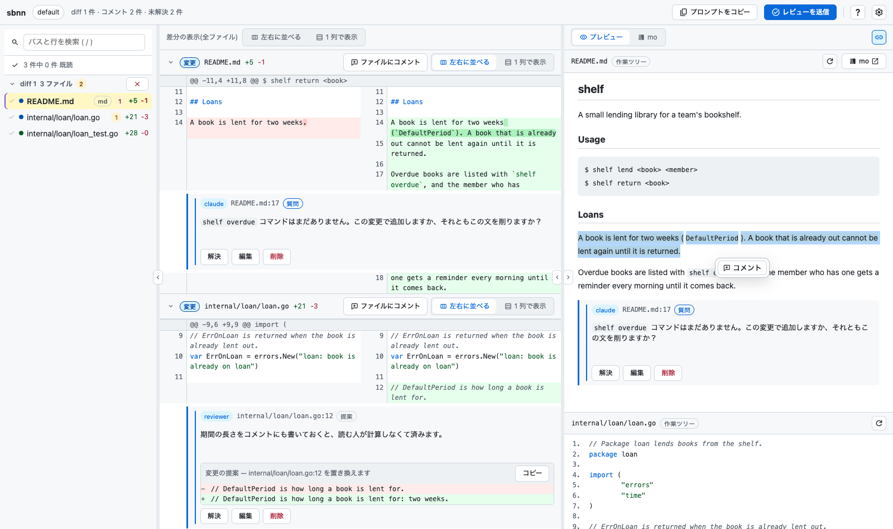

# sbnn

[English](README.md) | 日本語

diff ビューアー兼レビューツールです。名前は「sabun」（差分）から母音を抜いたもので、「さぶん」と読みます。

`sbnn` は unified diff をブラウザのレビューページとして表示します。左に GitHub
風の diff、右に Markdown のプレビューが並び、付けたレビューコメントはコマンドラインから読み出せます。



<sub>この画像は、コミット済みの `web/dist` を配信するバイナリで撮影したものです。そのため、ソースの最新の状態ではなく、ダウンロードした sbnn での見た目を示しています。撮影の条件と撮り直し方は
[`docs/screenshot.md`](docs/screenshot.md) にあります。</sub>

## 目次

- [インストール](#インストール)
- [使い方](#使い方)
  - [グループ](#グループ)
  - [スタックした pull request](#スタックした-pull-request)
  - [レビューする](#レビューする)
  - [誰も読まないファイルを折りたたむ](#誰も読まないファイルを折りたたむ)
  - [エージェントからのコメント](#エージェントからのコメント)
  - [レビューを終える](#レビューを終える)
  - [待つか起こしてもらうか](#待つか起こしてもらうか)
  - [コメントを読み出す](#コメントを読み出す)
  - [承認かコメントか修正依頼か](#承認かコメントか修正依頼か)
  - [ブラウザを使わずにレビューする](#ブラウザを使わずにレビューする)
  - [パイプラインに組み込む](#パイプラインに組み込む)
- [過去のレビューを振り返る](#過去のレビューを振り返る)
- [レビューをエクスポートする](#レビューをエクスポートする)
- [エージェントスキル](#エージェントスキル)
  - [スキルをインストールする](#スキルをインストールする)
  - [スキルが効いているか確かめる](#スキルが効いているか確かめる)
- [コマンドとフラグのリファレンス](#コマンドとフラグのリファレンス)
- [Markdown プレビューの仕組み](#markdown-プレビューの仕組み)
- [ファイルとポート](#ファイルとポート)
- [HTTP API](#http-api)
- [開発](#開発)
- [ライセンス](#ライセンス)

[difit](https://github.com/yoshiko-pg/difit) に着想を得ていますが、意図的に変えている点がいくつかあります。

- **sbnn は git を実行しません。** diff は標準入力から読むので、diff を出力できるものなら何でも使えます。`git diff`、`jj diff`、`diff -u`、`.patch` ファイル、コーディングエージェントなどです。
- **新規ファイルは unified 形式で表示します。** 並べて表示すべき変更前の内容がないからです。
- **Markdown は分割ペインでプレビューします。** diff と左右に並びます。プレビューは sbnn 自身が描画するので何もインストールする必要はなく、[mo](https://github.com/k1LoW/mo) をインストールすればより表現力の高いプレビューも使えます。
- **サーバーは 1 つで、セッションが育っていきます。** mo と同じように、最初の起動でバックグラウンドのサーバーが立ち上がり、以降の起動はそのサーバーに diff を追加します。
- **コメントはブラウザではなくサーバーに保存されます。** そのため、エージェントが `sbnn comments` でコメントを読めます。

## インストール

[リリースページ](https://github.com/tenntenn/sbnn/releases)からバイナリをダウンロードするか、Go でビルドします。

```console
$ go install github.com/tenntenn/sbnn@latest
```

どちらの方法でも、インストールはこれだけです。sbnn はレビューページを組み込んだ単一のバイナリで、Markdown プレビューも自分で描画するので、diff をパイプで渡す前に PATH に用意しておくべきものはほかにありません。

各リリースにはプラットフォームごとのアーカイブ（macOS、Linux、Windows のそれぞれ x86_64 と arm64）と、`checksums.txt` が含まれています。sbnn はどんな unified diff でも読めるので、使う人の多くは Go のコードをレビューしているわけではなく、Go のツールチェーンを入れておく理由がありません。CI のイメージやコンテナでも同じことです。macOS と Linux では次のようにします。

```console
$ tar xzf sbnn_Linux_x86_64.tar.gz
$ ./sbnn --version
```

バイナリを `PATH` の通った場所に移せばインストール完了です。

sbnn は `go.mod` に書かれた Go のバージョン、`go 1.27.3` でビルドされます。手元の Go がそこまで新しい必要はありません。Go 1.21 以降はデフォルトの `GOTOOLCHAIN=auto` がモジュールの要求するツールチェーンを取ってくるので、上のコマンドは古い Go でも動き、その旨を表示しながら進みます。

```console
$ go install github.com/tenntenn/sbnn@latest
go: github.com/tenntenn/sbnn@v0.0.0-... requires go >= 1.27.3; switching to go1.27.3
```

止まるのは `GOTOOLCHAIN=local` を設定している場合か、Go 1.20 以前を使っている場合だけです。その場合は、要求されたバージョンと実行中のバージョンの両方がメッセージに表示されます。

```console
$ GOTOOLCHAIN=local go install github.com/tenntenn/sbnn@latest
go: github.com/tenntenn/sbnn@latest: ... requires go >= 1.27.3 (running go 1.24.7; GOTOOLCHAIN=local)
```

その行が求めるバージョンまで Go を上げるか、`GOTOOLCHAIN` をデフォルトのままにしてツールチェーンを自動で取ってこさせてください。

`go install` はソースからビルドするので、バイナリはインストールしたときのモジュールのバージョンを報告します。タグの付いていないコミットなら `sbnn --version` は `dev` と表示し、`@v1.2.3` ならそのリリースを表示します。リリースページのバイナリには、ビルド元のタグが埋め込まれています。

## 使い方

```console
$ git diff | sbnn                      # start the server and review the diff
$ git diff --cached | sbnn             # add another diff to the same page
$ git diff HEAD~3 | sbnn -t refactor   # a named group with its own URL
$ diff -u old.md new.md | sbnn
$ cat change.patch | sbnn
```

最初の起動で <http://localhost:6280> にサーバーが立ち上がり、ブラウザが開いて、シェルに制御が戻ります。同じリポジトリでの以降の起動は、動いているサーバーに diff を追加します。

サーバーはリポジトリごとに 1 つです。sbnn はカレントディレクトリから `.git` まで遡ってリポジトリを特定します（ディレクトリを読むだけで、git は実行しません）。あるリポジトリの diff、コメント、レビューが別のリポジトリのサーバーに現れることはありません。最初にサーバーを起動したリポジトリがポート 6280、次が 6281、というように割り当てられます。どのリポジトリがどのポートを使うかは状態ディレクトリの `servers.json` に記録されるので、サーバーが停止して再起動しても、リポジトリのポートと URL は変わりません。worktree は追加元のリポジトリに属してそのサーバーを共有し、チェックアウトごとの区別は `--target` で付けます。submodule はそれ自体が 1 つのリポジトリとして扱われ、どのリポジトリの外から送られた diff にも専用のサーバーが用意されます。

どのコマンドも、実行したリポジトリのサーバーを見つけます。`--port`（`-p`）で番号を指定してサーバーを選ぶこともできますが、別のリポジトリに属するサーバーは混ざらないように拒否されます。`sbnn --status -p 6281`、`--shutdown`、`--restart` はどのサーバーにも使えますが、それ以外は今いるリポジトリのサーバーにしか使えません。

```console
$ sbnn --status          # what is being reviewed
$ sbnn --status --all    # every repository's server, running or not
$ sbnn --clear -t api    # close that review: its diffs, comments and hooks
$ sbnn --clear --all     # close every review the server holds
$ sbnn --restart         # restart, keeping the session
$ sbnn --shutdown        # stop the server
$ sbnn prune --dry-run   # what a prune would close and remove
$ sbnn prune             # close the reviews left alone for a week
```

ヘッダーの設定メニューにある **レビューを閉じる**（Close review）は、表示中のレビューに対して同じことをします。役目を終えたレビューに使ってください。レビューを閉じることとサーバーを止めることは別物です。`--shutdown` は何も消さずに止め、`--restart` で元に戻せますが、閉じたレビューは破棄されます。

サーバーは、何も保持していない状態（diff も hook も開いているレビューページもない状態）が 30 分続くと自動で終了します。そのため、終わったレビューのプロセスが次の再起動までポートに居座ることはありません。人間のレビューを待っているレビューは、どれだけ長く待っていても回収されません。このチェックが見ているのは「何かが残っているか」であって、「最近何かが起きたか」ではないからです。この時間は `--idle-timeout` で設定でき、`--idle-timeout 0` にするとサーバーは常駐し続けます。

```console
$ git diff | sbnn --idle-timeout 4h   # stay up longer
$ git diff | sbnn --idle-timeout 0    # stay up until told to stop
```

残るのは、誰も閉じなかったレビューです。diff を送ってそのまま次に進むエージェントは、レビューをサーバーに置きっぱなしにします。それが数か月も続けば、サイドバーは二度と開かれないレビューで埋まります。`sbnn prune` は、1 週間何も起きていないレビュー（diff の送信、コメントの作成や編集、レビューの送信、hook の登録や実行のいずれもなかったもの）を閉じます。`--older-than` には別の期間や日付（`30d`、`36h`、`2026-01-31`）を、`sbnn reviews --since` と同じ書き方で指定できます。

```console
$ sbnn prune --dry-run           # what would be closed, what is kept and why
$ sbnn prune --older-than 30d    # close what has been left for a month
```

古いレビューでも、未解決のコメントや、レビューを待っている hook が残っているものは残され、prune はどれをなぜ残したかを表示します。`--force` を付けると、それらも閉じます。prune が閉じるのは、実行したリポジトリのサーバー上のレビューです。別のサーバーを対象にするには、そのリポジトリで実行するか `--port` を指定してください。`--clear --all` と同じく、閉じようとしているものを一覧表示して確認を求めます。`--yes` を指定した場合や、端末の前に誰もいない場合は確認しません。

prune は、もう動いていないサーバーの後片付けもします。状態ディレクトリには、これまでサーバーが動いたポートごとに `session-<port>.json` と `server-<port>.log` が残っています。sbnn サーバーが応答しないポートについて、そのセッションのレビューがすべて同じルールで閉じられる状態であれば、prune はその 2 つを削除します。動いているサーバーのファイルには手を触れず、`sbnn reviews` が読むログである `reviews.jsonl` も削除しません。ディレクトリがなくなっていて、サーバーがセッションも残していないリポジトリは `servers.json` から外され、そのポートは再び割り当てられるようになります。sbnn が diff から再構成した Markdown プレビューは、そのレビューを保持するサーバーも残っているセッションもなくなった時点で削除されます。レビューを閉じたときや、`--replace` でラウンドを置き換えたときは、そのプレビューがすぐに削除されます。

### グループ

`--target`（`-t`）を使うと、diff を名前付きのグループに入れられます。グループはそれぞれ専用の URL、コメント、レビューを持ちます。グループが何を表すかは自由です。タスクでも、ブランチでも、別のチェックアウトと並べて開いておくチェックアウトでも構いません。sbnn はそのあたりを推測しようとはせず、分けておくよう頼まれたものを分けておくだけです。

`SBNN_TARGET` を使えば、シェル全体に対して一度だけ指定できます。複数のレビューを同時に回すスクリプトやエージェントには、こちらが便利です。

```console
$ export SBNN_TARGET=hotfix
$ git diff | sbnn            # http://localhost:6280/hotfix
$ sbnn comments              # the comments of the same review
$ sbnn comments -t default   # the flag still wins
```

グループとラウンドは大きさの違う単位で、言葉も意図的に使い分けています。**グループ**はレビュー全体（URL、コメント、履歴）を指し、**ラウンド**はそこに送られた 1 つの diff を指します。グループは最初は 1 つのラウンドを持ち、新しい diff をパイプで渡すたびにラウンドが 1 つ増えます。後で出てくる「次のラウンドを始める」とは、同じグループに diff をもう 1 つ送ることです。

### スタックした pull request

sbnn は GitHub が何かを知らず、`git` も `gh` も自分では実行しませんが、特別な仕組みがなくてもグループはスタックした pull request にそのまま対応させられます。ブランチごとに 1 つのグループを作り、main ではなく 1 つ下のブランチとの diff を取れば、各グループにはそのブランチ自身の変更だけが入ります。

```console
$ git diff origin/main...feature-1 | sbnn --target feature-1 --label pr=101
$ git diff feature-1...feature-2   | sbnn --target feature-2 --label pr=102
$ git diff feature-2...feature-3   | sbnn --target feature-3 --label pr=103
```

PR の番号や URL を持ち運ぶのは `--label` です。sbnn はこれを保存するだけで中身を解釈しません。ラベルは `sbnn reviews` にも引き継がれるので、後からラウンドを元の PR と突き合わせられます。2 つ以上のグループが開いていると、サイドバーの **グループ**（Groups）一覧がリンクの積み重ねになります。レビュー中のブランチごとに 1 つのリンクがあり、それぞれ diff の数と未解決のコメント数が表示されます。sbnn がスタックとは何かを知らなくても、これがそのままスタックの形として読めます。

どれも必須ではありません。スタックのレビューはデフォルトのグループだけでも、ラベルなしでもできます。これは、sbnn の「グループごとに 1 つのレビュー」というモデルを、GitHub の「PR ごとに 1 つのレビュー」というモデルにそろえるための形にすぎません。

### レビューする

- コメントする行は、行番号の上をドラッグするか、Shift を押しながらクリックするか、タッチスクリーンならコメントの下書きを開いた状態で 1 行タップしてから別の行をタップして選択します。
- **キーボードでは、Tab で行番号に移動して Enter か Space を押します。** どの行番号もタブ順に含まれていて、Shift を押しながら押すと、Shift クリックと同じように選択範囲を広げられます。`?` で開く一覧にも同じことが書いてあります。
- **プレビューの文章を選択してコメントできます。** ドラッグを終えると、ポインタを離した位置に **+** が現れます。これを押すと同じコメント欄が開き、選択したブロックの元になったソースの行にコメントが紐付きます。選択範囲はコメントを書いている間ハイライトされたままで、ほかの場所をクリックするか、Escape を押すか、キャンセルまたは投稿すると消えます。この機能には、sbnn 自身によるファイル全体のプレビューが必要です。mo は sbnn が読めないフレームの中で描画され、一部だけのプレビューではどこが何行目かを特定できないからです。
- **変更を提案**（Suggest a change）を押すと、コメントに ` ```suggestion ` ブロックが挿入され、その行の現在の内容があらかじめ入ります。GitHub と同じ形です。このブロックは小さな diff（現在の行と提案後の行）として表示され、`sbnn comments` ではフェンス付きブロックのまま渡されるので、エージェントはそのまま適用できます。1 つのコメントに文章と複数の提案のどちらも、あるいは両方を含められます。
- コメントは解決、編集、削除ができ、ページを再読み込みしても残ります。
- **プロンプトをコピー**（Copy prompt）を押すと、未解決のコメントがすべてクリップボードにコピーされ、そのままコーディングエージェントに渡せます。
- 変更前と変更後を **左右に並べる** か **1 列で表示** するかは、ファイルごとに切り替えられます。新規、削除、バイナリのファイルは常に 1 列で表示します。
- **ファイル一覧は、パスと diff の内容で検索できます。** `/` を押して入力します。空白で区切ったすべての語が、大文字小文字を区別せずに、パスのどこかに現れるか、diff の 1 行の中にすべてそろって現れる必要があります。たとえば `server go` でも `internal/server` でも、パスで `internal/server/server.go` が見つかり、`handleHealthz` なら diff 中でそれに触れているファイルが見つかります。パスと行の結果は合算されません。パスで見つかった語と行で見つかった語を合わせても一致にはなりません。どちらも両方の語を含んではいないからです。各行にはどこで一致したかが `path`、`2 lines`、`path + 3 lines` のように表示され（日本語の UI では「パス」「2 行」など）、検索ボックスには `2 of 3` のように件数が表示されます。行でも一致があれば、末尾に `, 2 lines` が付きます。diff に含まれる行は、追加、削除、変更なしの区別なくすべて検索対象です。Enter を押すと、残っている最初のファイル（内容だけで一致したファイルの場合もあります）を開きます。移動先は行ではなくファイルです。Escape で検索をクリアします。入力したものを含まないものが出てくることはありません。目で追う一覧に、気の利いたあいまい検索は不要だからです。20 万行を超えると内容の検索は打ち切られてその旨が表示されますが、パスは引き続きすべて検索されます。
- レビューの各ラウンド（グループに送られた各 diff）には、ファイル一覧の中にそれぞれ見出しが付きます。見出しをクリックするとそのラウンドを閉じられます（閉じても、中のファイル数と未解決のコメント数は見出しに表示され続けます）。また、一覧を **タブ** に切り替えると、ラウンドを 1 つずつ表示できます。検索はタブにも効きます。一致するもののないラウンドはタブの列から消え（入力した語との接点が内容の 1 行だけでも、そのラウンドは残ります）、残ったタブには一致したファイル数が表示されます。検索によって、選んだレイアウトが勝手に切り替わることはありません。
- どのペインもサイズを変えられ、最小化して隠すこともできます。2 つのペインの境界をドラッグするとサイズが変わり、ダブルクリックするとリセットされます（ファイル一覧の場合は一覧が隠れます）。ヘッダーの **ファイル**・**diff**・**プレビュー** の切り替えも使えます。境界を端までドラッグするとそのペインは最小化され、ドラッグして引き出すかダブルクリックすると元に戻ります。レイアウトはブラウザごとに記憶されます。
- Markdown ファイルにはプレビューペインが付きます。デフォルトでは sbnn 自身が描画します。何もインストールする必要がなく、スクロールに合わせて diff に追従することもできます。プレビューのヘッダーで mo を選ぶと、代わりに **mo** が描画します。この選択は記憶されます。プレビューには、作業ツリーにファイルがあればそれを表示します。なければ sbnn が diff から変更後の内容を再構成します。新規ファイルなら完全に再構成できますが、変更されたファイルでは一部だけになります（unified diff には変更のあった hunk しか含まれないからです）。一部だけの再構成では、ヘッダーに **一部のみ**（partial）と表示され、diff に含まれていない範囲ごとに、区切り線と何行欠けているかを示す行が Markdown の中に差し込まれます。notebook にはこの差し込みは行いません。notebook は JSON なので、途中に sbnn の文が入ると、それが原因でまったく表示できなくなってしまうからです。
- それ以外のテキストファイル（`.go`、設定ファイル、拡張子のないスクリプトなど）にもプレビューが付きます。ファイル全体を行番号付きで表示し、diff と同じルールでシンタックスハイライトします。中身は同じく作業ツリーのファイルか再構成したもので、ヘッダーにも同じく **作業ツリー**（tree）／**再構成**（rebuilt）／**一部のみ**（partial）と表示されます。最初の 2,000 行だけを描画し、残りはボタンで表示するので、生成されたファイル 1 つで 10 万行がペインを埋め尽くすことはありません。エクスポートしたページには読み込める作業ツリーがないため、プレビューは Markdown、notebook、画像のものだけが残ります。
- **スクロール同期**を有効にすると、プレビューが diff のスクロールに追従します。追従は行単位ではなく、全体に対する割合で行います。2 つの文書の行は対応していないので、対応しているふりをすると、自信満々に間違った場所に連れて行くことになるからです。プレビューを自分でスクロールすると、その位置で追従が止まり、切り替えボタンで再び有効にできます。これは sbnn 自身のプレビューでしか動きません。mo は別オリジンのフレームに表示されるため、ページからそのスクロールを操作できないからです。
- `?` を押すとキーボードショートカットが表示されます。`j`/`k` でファイル間を、`n`/`p` でコメント間を移動し、`f` で折りたたみ、`v` で左右に並べる表示と 1 列の表示を切り替え、`s` でスクロール同期を切り替え、`r` でレビューの送信欄を開き、`/` でファイル一覧を検索します。文字の入力中はどれも反応しません。ヘッダーの **?** ボタンでも同じ一覧が開きます。
- ブラウザで初めてレビューを開くと、短い画面ツアーが始まり、ファイル一覧、diff、プレビュー、行へのコメントのしかた、レビューの終え方を案内します。Esc でスキップでき、`?` の一覧にある **画面ツアーをもう一度見る**（Show the tour again）でまた見られます。ブラウザが何も保存させてくれない環境（サンドボックス化されたフレームや、サイトデータがブロックされている場合）では、ツアーは自動では開きません。一度見たことを覚えておけないからです。
- 設定の **テーマ** では **システムの設定に合わせる／ライト／ダーク**（Auto / Light / Dark）を選べます。「システムの設定に合わせる」はシステムの設定（エクスポートしたページなら、それを表示している環境の設定）に従います。選んだテーマはブラウザごとに記憶されます。Markdown プレビューは mo 自身のテーマのままです。mo にはプレビュー内のツールバーに専用の切り替えがあります。
- 設定の **言語**（Language）では **自動／English／日本語** を選べます。「自動」はブラウザの言語リストに従い、2 つのうちリストで先に出てくるほうを使います。どちらもなければ英語です。エクスポートしたページでも同じで、選んだ言語はブラウザごとに記憶されます。**プロンプトをコピー** でクリップボードにコピーされるプロンプトは英語のままです。ページではなく、エージェントに向けて書かれたものだからです。
- 設定の **新しい diff を通知**（Notify on new diff、デフォルトはオフ、ブラウザごとに記憶）を有効にすると、タブがバックグラウンドにある間に新しい diff が届いたとき、タブのタイトルに `(n)` が付き、ブラウザの通知が表示されます。通知の許可を求めるダイアログは、この設定をオンにしたときに表示されます。許可しなかった場合は、タイトルの印だけが使われます。エクスポートしたページでは使えません。
- スマートフォンでは、**ファイル／diff／プレビュー** のタブバーでペインを 1 つずつ表示し、diff は 1 列で表示します。プレビューはページ自身が描画します。mo はフレームの中に自前のサイドバーを持っていて、読むには狭すぎる列しか残らないからです。**mo で開く**（Open in mo）を押すと、本物の mo のページが別のタブで開きます。

### 誰も読まないファイルを折りたたむ

diff には、誰も 1 行ずつ読まないファイルがよく含まれます。ロックファイル、ビルド成果物のディレクトリ、生成されたバインディングなどです。sbnn はそうしたファイルを折りたたみます（隠すのではなく、閉じておくだけです）。折りたたむ理由はちょうど 2 つだけで、どちらも sbnn 自身の判断ではありません。

**送り手が指定した場合。** 生成ファイルの名前を知っているのは diff を作った本人なので、その情報は diff と一緒に渡してもらいます。

```console
$ git diff | sbnn --collapse 'go.sum' --collapse 'web/dist/**'
$ git diff | sbnn --collapse "$(git ls-files ':(attr:linguist-generated)' | paste -sd,)"
```

パターンは `.gitignore` と同じように働きます。スラッシュを含まないパターンは任意の深さの名前にマッチし、`**` は任意の数のディレクトリを表し、末尾の `dir/**` は `dir` そのものではなく `dir` の中身を指します。つまり `--collapse 'web/dist'` は何も折りたたみませんが、`--collapse 'web/dist/**'` はその下をすべて折りたたみます。sbnn はパターンをマッチさせるだけで、それ以上の意味は読み取りません。生成ファイルとは何かを知らず、`.gitattributes` も自分では読みません。それをすると、sbnn が git について知っていることになってしまうからです。

1 つの `--collapse` にはリストを渡せます。区切り文字はカンマと改行の 2 つです。`--collapse 'go.sum,web/dist/**'` は 2 つのパターンになり、1 行に 1 パターンを書いたファイルを使う `--collapse "$(cat .sbnnignore)"` も同様です。後者は特に便利な区切り方で、ループを書かずにファイル全体を sbnn に渡せます。フラグは繰り返し指定もできるので、リストを 1 つにまとめずに分けて書くこともできます。

カンマを区切り文字にした代わりに、使えなくなるファイル名があります。カンマを含むパスは、パターンとしてまったく書けません。`--collapse 'docs/a,b.md'` は `docs/a` と `b.md` になり、どちらも何にもマッチしません。フラグを繰り返しても解決しません。どの値も同じように分割されるからです。カンマの代わりに 1 文字のワイルドカードを使って `--collapse 'docs/a?b.md'` と書くか、手でファイルを折りたたんでください。

**ファイル自身が宣言している場合。** 先頭付近に `// Code generated by … DO NOT EDIT.` や `@generated` があるファイルは、自分が何者かを宣言しています。その行は、ツールに手を出させないために、ジェネレーターがわざわざ書いたものです。同じ宣言を日本語で書いたものも数に入ります。生成されたファイルは、日本語でそう書いたからといって生成されたファイルでなくなるわけではないからです。ファイルが生成されたこと（`自動生成`、`自動的に生成`、`generated`）と、編集すべきでないこと（`編集しないでください`、`編集不可`、`変更禁止`）の両方を述べている行は、英語の宣言と同じように扱われます。どちらか一方だけなら普通の文章です。`テンプレートからコードを自動生成する` はパッケージが自分の役割を説明しているだけですし、`編集不可` は UI のラベルかもしれません。片方だけで折りたたむと、手書きのコードがレビューから隠れてしまいます。英語のパターンも、以前から両方がそろうことを求めています。

`このファイルは…生成されました` と `自動生成されたファイルです` には、もう半分は必要ありません。このファイルそのものが生成されたものだと名指ししていること自体が宣言だからです。sbnn は見つけた行を表示します。

```
Folded — the file says so: // Code generated by protoc-gen-go. DO NOT EDIT.
Folded — the file says so: // このファイルは自動生成されています。編集しないでください。
```

それでも、移植性の高い答えは `@generated` です。sbnn だけでなく GitHub などにも理解されるので、自分で管理しているジェネレーターなら出力しておく価値があります。

サイズ、パス、拡張子で折りたたむことはありません。それは何も知らないプロジェクトについて sbnn が推測することになりますし、間違った理由で折りたたまれたファイルは誰にも読まれなくなるからです。同じ理由で、折りたたまれたファイルも一覧の行と `+`/`-` の行数はそのまま残り、1 クリックで開け、コメントが付いている間は折りたたまれません。どのファイルも、ヘッダーの折りたたみボタン（**このファイルを折りたたむ**）で手動で折りたためます。これには何の判断も要りません。

### エージェントからのコメント

やり取りは双方向です。エージェントは自信のない行を指し示したり、質問したり、変更を提案したりでき、それがブラウザ上で diff の横に、誰が書いたかのラベル付きで表示されます。

```console
$ sbnn comment internal/server/server.go:120 -m "Should this be a 404?" --author claude
$ sbnn comment README.md:12-18 -m "Reworded" --suggest-file new.md --author claude
$ cat new.txt | sbnn comment main.go:42 -m "Simpler" --suggest -
```

`--suggest` は置き換え後の内容を ` ```suggestion ` ブロックとしてコメントに追加します。同じブロックを `-m` に直接書くこともできます。

`--question` は、そのコメントが変更ではなく回答を求めていることを示します。ブラウザでは、コメント欄の横の **質問**（Question）が同じ役割です。この 2 種類の依頼は文章だけでは区別がつかない（「これは 404 にすべきでは？」はどちらとも取れます）ので、コメントを書く側がどちらなのかを示し、`sbnn comments` が読み手に *This one is a question: answer it.*（これは質問なので、答えてください）と伝えます。

行番号は diff に表示されている行番号です（削除された行なら `--side old` を付けます）。ファイルはそのパスを含む最新の diff から探され、レビュー対象のコードは sbnn が自分で埋めます。

行を付けずにパスだけを指定すると、ファイル全体へのコメントになります。

```console
$ sbnn comment new.txt -m "this rename looks wrong"
$ sbnn comment exec.sh -m "why is this now executable?"
```

行を 1 つも含まないファイル（純粋なリネーム、モードの変更、バイナリファイル）について何か言うには、これが唯一の方法です。それ以外のファイルでも、ファイルに対するコメントとして読まれます。このコメントは行の下ではなくファイルのヘッダーの下に表示され、ブラウザではファイルのヘッダーにある **ファイルにコメント**（comment on file）が同じ役割をします。提案はコメントが指す行を置き換えるものなので行範囲が必要で、ファイル全体へのコメントには付けられません。

セルフレビューをまとめて投稿することもできます。

```console
$ sbnn comment --json --author claude <<'EOF'
[
  {"path": "cmd/root.go", "line": "88", "body": "left over from the old flag"},
  {"path": "README.md", "line": "12-18", "body": "reworded", "suggestion": "..."},
  {"path": "new.txt", "body": "this rename looks wrong"}
]
EOF
```

`"line"` を省いたエントリーは、パスだけを指定した場合と同じファイル全体へのコメントになります。

### レビューを終える

ヘッダーの **レビューを送信**（Submit review）は「見終わった」という意思表示です。sbnn はこのタイミングで、待っているすべてのもの（エージェント、スクリプト、別のマシン）に、コメントを読む価値がある状態になったことを伝えます。送信時にはもう 1 つ、変更全体についての判断を **承認**（Approve）、**コメントのみ**（Comment）、**修正を依頼**（Request changes）のいずれかで求められます。pull request のレビューと同じ 3 つです。任意でメモを添えることもでき、プロンプトの先頭に表示されます。別の diff を送ると次のラウンドが始まり、グループは再び未レビューの扱いになります。

この判定は、個々のコメントの内容とは別の問いです。だからこそ sbnn はコメントを数えるのではなく、直接尋ねます。3 つ指摘を付けたうえで承認するのはよくあることですし、1 行も指し示さずに変更を差し戻すこともよくあります。レビューを読む側には、どちらだったかがそのままの言葉で伝わります。`sbnn comments` の冒頭は "The reviewer approved the change; anything below is worth reading but does not block it"（レビュアーは変更を承認した。以下は読む価値はあるが、マージを止めるものではない）や "asked for changes; the change should not go ahead as it is"（修正を依頼した。このままでは変更を進めるべきではない）のようになります。

### 待つか起こしてもらうか

レビューが届くのは、人間の準備ができたときです。会議の後かもしれないし、昼食の後かもしれないし、明日かもしれません。そのときに居合わせる方法は 2 つあります。

**待つ。** `sbnn wait` はサーバーのイベントストリームでブロックします。ポーリングはせず、取りこぼしもありません。すでにレビューが済んでいれば、すぐに戻ります。

```console
$ git diff | sbnn --target api
$ sbnn wait --target api                 # returns when the review is submitted
$ sbnn wait --target api --timeout 30m   # exits with status 2 if it is not
```

**あるいは、サーバーに作業を始めてもらう。** やることを登録して立ち去れば、人間が「レビューを送信」を押したときに、誰かがまだいるかどうかに関係なく sbnn がそれを実行します。

```console
$ git diff | sbnn --on-review 'claude -p "$(sbnn comments)"'
$ sbnn hook --on-review-url http://localhost:9000/reviews   # a POST instead
$ sbnn hook            # what is registered, and how it went last time
$ sbnn hook --clear
```

URL の hook は登録時にチェックされます。sbnn が POST できるのは `http` と `https` だけなので、それ以外は 400 で拒否されます。保存しておいてレビューのたびに失敗し、ログファイルに記録されるのではなく、まだその場にいて読めるうちに拒否されるわけです。`sbnn hook` は各 hook の前回の実行結果も一覧表示するので、失敗し続けている hook に、次のレビューの後ではなく前に気付けます。

```console
$ sbnn hook
h1  POST http://localhost:9000/reviews
      last post: failed, 2026-08-25T09:00:00+09:00 - connection refused
```

コマンドはシェル経由で実行され、標準入力にはレビューのプロンプトが渡され、環境変数には `SBNN_GROUP`、`SBNN_URL`、`SBNN_SERVER`、`SBNN_PORT`、`SBNN_COMMENTS`、`SBNN_REVIEW_NOTE` が設定されます。`SBNN_SERVER` と `SBNN_PORT` は、レビューが送信されたサーバーを示します。hook の中で実行する `sbnn comments` は、そのリポジトリで実行されていれば自分で同じサーバーを見つけますし、`sbnn comments -p "$SBNN_PORT"` で明示することもできます。hook はグループに属し、再起動後も残ります。hook は自分のマシンで自分のコマンドを実行します。それこそが hook の便利さであり、慎重に扱うべき理由でもあります。

### コメントを読み出す

```console
$ sbnn comments                              # Markdown, ready to paste into an agent
$ sbnn comments --format json                # machine readable
$ sbnn comments -t api                       # comments of the "api" group
$ sbnn comments --clear --resolved-only      # start the next round, keeping what is open
$ sbnn comments --clear                      # ... and drop the open ones as well
```

`--clear` は、コメントに対応したかどうかに関係なくグループを空にするので、まだ誰も答えていない指摘も一緒に消えます。ラウンドの合間に使うべきなのは `--resolved-only` です。解決済みのコメントだけを削除し、残りは次の回に持ち越します。

どちらも diff には手を触れないので、対応したばかりのラウンドの diff は、修正版の隣に残ったままです。次のラウンドを `--replace` 付きで送ると、グループがそれまで保持していた diff を、そこに付いたコメントごと削除します（hook と、それ以外に付いたコメントは残ります）。

```console
$ <diff> | sbnn --replace
```

空の diff では何も置き換わらず、グループが保持していた diff はそのまま残ります。sbnn は標準エラー出力にその旨（`sbnn: the diff is empty, so nothing was replaced; ...`）を出力しますが、レビューページは開けるので終了ステータスは 0 です。置き換えに成功したかどうかは、URL ではなく標準エラー出力で判断してください。

### 承認かコメントか修正依頼か

レビューは 2 つの異なることを伝えます。特定の行の何が問題なのかと、レビュアーが変更全体についてどう判断したかです。コメントを数えても後者の答えにはなりません。指摘が 3 つ付いたまま承認されることもあれば、1 行も指摘されずに差し戻されることもあります。そのため sbnn はこれを直接尋ねます。ブラウザには 3 つのボタンがあり、`sbnn submit` も同じ 3 つを受け付けます。`--exit-code`、エージェントが読むプロンプト、ログは、いずれもこの判定を繰り返し伝えます。

### ブラウザを使わずにレビューする

レビュアーは人間でなくても構いません。コメントはコマンドラインから付けられ、`sbnn submit` が送信ボタンの役割を果たします。待っている相手を起こし、hook を開始し、ラウンドをログに書き込みます。

```console
$ sbnn comment internal/server/server.go:166 --author code-review \
    -m "any site can POST here, and a hook is a shell command sbnn runs"
$ sbnn comment --json --author code-review < findings.json   # many at once
$ sbnn submit --approve -m "fine by me"                      # it can go ahead
$ sbnn submit --request-changes -m "not like this"           # it should not
$ sbnn submit -q && echo "nothing blocking"                  # 0 clear, 1 not
```

こうしたレビューを、単に自信ありげなだけでなく検証可能なものにしているのは 2 つの点です。各コメントが `path:line` に紐付き、対象のコードと一緒に保存されること、そして `--author` によって人間が書いたものと区別されることです。だからこそ、後からログを読む価値があります。機械が人間と同じ箇所を指摘していたかどうかを確かめられるのです。

```console
$ sbnn reviews --comments | awk -F'\t' '{print $4}' | sort | uniq -c
```

### パイプラインに組み込む

sbnn は diff を標準入力から読み、テキストを標準出力に書くので、すでに使っているコマンドを置き換えるのではなく、それらと組み合わせて使えます。`sbnn comments` と `sbnn wait` は、見つけた結果を終了ステータスでも伝えます。対応すべきものがなければ 0、あれば 1、`sbnn wait` でまだレビューが済んでいなければ 2 です。次の処理を止めるにはこれで十分です。

```console
$ git diff | sbnn
$ sbnn wait -q && git commit -m "..."      # commit once the review is clean
$ sbnn comments -q || echo "still something to fix"
$ sbnn reviews --comments | cut -f3 | sort | uniq -c | sort -rn
```

sbnn は作業ツリーに何も書き込みません。セッション、ログ、再構成したプレビューはすべて作業ツリーの外に置かれるので、`git status` の結果はレビューの前後で変わりません。標準出力と標準エラー出力が端末でない場合はブラウザを開かないので、ジョブやパイプラインの中では、`--open` を指定しない限り静かに動きます。

## 過去のレビューを振り返る

送信されたレビューはすべて記録されるので、ラウンドが属していたグループと一緒に消えてしまうことはありません。

```console
$ sbnn reviews                     # one line each, newest last
$ sbnn reviews --since 7d          # this week
$ sbnn reviews -t api --limit 5
```

```
2026-08-16 03:26  default    2 comment(s), 1 suggestion(s)  3 file(s), +11 -1  waited 42m
      Mostly fine
2026-08-16 11:02  api        1 comment(s)  3 file(s), +11 -1  waited 3h10m  branch=main
```

`--stats` は複数のレビューをまとめて集計します。出力するのは、指定したときだけです。

```console
$ sbnn reviews --stats
2 review(s), 3 comment(s) (1.5 per review), 1 suggestion(s)
median wait from diff to review: 1h24m
most commented:
  internal/server/server.go                7
  README.md                                5
by kind of file:
  .go                                     22
  .md                                      9
by author:
  reviewer                                31
  claude                                   8
```

それ以外の分析は sbnn の仕事ではありません。sbnn はデータを、レコードのストリームを扱うのが得意な既存のツールに渡し、何を数えるかはパイプ次第です。`--comments` を付けると、ログをコメント 1 件ごとのレコードに変換します。解析するなら jsonl 形式を使ってください。1 行に 1 つのフラットな JSON オブジェクトで、フィールドは今後追加されることはあっても名前が変わることはありません。テキスト形式はタブ区切りの 5 列（日付、グループ、`path:lines`、作成者、本文の 1 行目）です。目で見たり手軽にパイプに通したりするには十分ですが、意図的に情報を落としています。本文全体を含むのは jsonl だけです。

```console
$ sbnn reviews --comments --format jsonl | jq -r 'select(.suggestions) | .path'
$ sbnn reviews --comments | cut -f3 | cut -d: -f1 | sort | uniq -c | sort -rn
$ sbnn reviews --comments --since 90d | awk -F'\t' '{print $4}' | sort | uniq -c
```

diff は `--label key=value`（繰り返し指定可）付きで送ることができ、そのペアはレビューの記録に引き継がれます。sbnn はそれを保存するだけで、中身は解釈しません。リビジョン、ブランチ、チケットなど、後で突き合わせたいものなら何でも構いません。

```console
$ git diff | sbnn --label rev=$(git rev-parse --short HEAD)
$ sbnn reviews --format jsonl | jq -r '"\(.labels.rev // "-")\t\(.comments | length)"'
```

付け忘れたラベルも失われたわけではありません。ログはただのファイルなので、後から `jq` で書き換えられます。

ログ自体は `$XDG_STATE_HOME/sbnn/reviews.jsonl` にある 1 行 1 JSON オブジェクトのファイルです（別の場所に置くには `--history-file` か `$SBNN_HISTORY` を、記録しないなら `off` を指定します）。`jq` でそのまま扱え、sbnn 固有の形式は何もありません。`sbnn reviews --file` はそうしたファイルなら何でも読み、`-` を指定すると標準入力から読みます。複数のログはこうして組み合わせられます。

```console
$ jq -r '.comments[].path' ~/.local/state/sbnn/reviews.jsonl | sort | uniq -c | sort -rn
$ cat mine.jsonl theirs.jsonl | sbnn reviews --file - --stats
```

ログは作業ツリーの外に置いてください（デフォルトでは外にあります）。作業ツリーの中にあるログは送信のたびに追記され、まさにそのログが記録している diff を汚してしまいます。ログは記録したマシンにだけ残ります。すべて忘れたいときは、ファイルを削除してください。

## レビューをエクスポートする

`sbnn export` は、レビュー全体を自己完結した 1 つの HTML ページとして書き出します。UI は同じで、diff はページに固定され、裏にサーバーも mo もネットワークも必要ありません。sbnn を使っていない人にレビューを届ける方法で、メールに添付したり、バケットに置いたり、artifact として公開したりできます。

```console
$ git diff | sbnn export review.html    # straight from stdin, no server needed
$ sbnn export -t api review.html        # the "api" group of a running server
$ git diff | sbnn export                # to stdout
$ git diff | sbnn export --fragment page.html   # body only, to embed elsewhere
```

エクスポートしたページでは diff は読み取り専用ですが、レビューはできます。コメントの作成、解決、編集ができ（コメントはそのブラウザに保存されます）、Markdown は mo ではなくページ自身が描画し、**プロンプトをコピー** は `sbnn comments` とまったく同じ内容を出力します。

## エージェントスキル

sbnn には、特定のベンダーに依存しないエージェントスキルが付属しています。YAML front matter 付きの Markdown ファイル 1 つで、レビューのループ（diff を送り、URL を人間に渡し、コメントを読み出し、対応し、次のラウンドを始める）を、すべて sbnn のコマンドラインの言葉で説明しています。ベンダー固有の内容は何もないので、指示ファイルを読めるエージェントなら何でも使えます。

ソースは [`skills/sbnn/SKILL.md`](skills/sbnn/SKILL.md) で、バイナリに埋め込まれています。そのため、インストールされるスキルは、実行している sbnn と常に一致します。

### スキルをインストールする

```console
$ sbnn skill                          # print SKILL.md to stdout
$ sbnn skill --list                   # list the files the skill consists of
$ sbnn skill --install <dir>          # write <dir>/sbnn/SKILL.md
$ sbnn skill --install <dir> --force  # overwrite an older copy
```

`--install` は、指定したディレクトリの中に `sbnn/` ディレクトリとしてスキルを書き込みます。`--force` を指定しない限り既存のファイルは上書きしないので、sbnn をアップグレードした後の再インストールは 1 行で済みます。

```console
$ sbnn skill --install ~/.claude/skills --force
```

`--force` は、中身が何であってもスキルを置き換えます。インストールされた各 `SKILL.md` には、それを書き込んだ sbnn のリリース（`metadata.version`）が記録されていて、`sbnn skill --refresh <dir>` はそれを使います。手元の sbnn のほうが新しい場合にだけ再インストールし、より新しい sbnn が書いたスキルは古い内容で置き換えずにそのまま残します（その場合は sbnn をアップグレードすべきだと表示します）。ソースからのビルド（`dev`）はリリースを記録せず、リリース版のスキルを上書きすることはありません。スキルはこのコマンドを使って自分自身を最新に保ちます。

`<dir>` に何を指定すべきかはエージェントによって異なります。よく使われるものは次のとおりです。

| エージェント | コマンド |
| --- | --- |
| Claude Code（このプロジェクトのみ） | `sbnn skill --install .claude/skills` |
| Claude Code（すべてのプロジェクト） | `sbnn skill --install ~/.claude/skills` |
| `AGENTS.md` を読むもの（Codex、Jules など） | `sbnn skill --install .agents/skills` の後、リンクを張る（下記参照） |
| 独自のルールディレクトリを持つもの（Cursor、Cline など） | そのディレクトリにインストールする。パスと期待されるファイル名はエージェントのドキュメントを確認すること |
| スキルにまったく対応していないもの | `sbnn skill >> AGENTS.md`（またはそのエージェントの指示ファイル） |

スキルディレクトリではなく `AGENTS.md` を読むエージェントの場合は、ファイルをインストールして `AGENTS.md` からリンクします。

```markdown
## Reviewing changes

Before showing a diff to a human, read [.agents/skills/sbnn/SKILL.md](.agents/skills/sbnn/SKILL.md).
```

このリポジトリでもまさにそうしています。[`AGENTS.md`](AGENTS.md) を見てください。

### スキルが効いているか確かめる

エージェントに何かのレビューを頼み、何を実行するかを見てください。diff を `sbnn --target <topic>` にパイプで渡し、URL を伝え、待ってから、`sbnn comments` でコメントを読むはずです。そうならない場合、ほとんどのエージェントはセッション開始時にスキルディレクトリを読み込む必要があるので、インストール後に新しいセッションを始めてください。

## コマンドとフラグのリファレンス

この README のほかの部分では、フラグは説明の流れの中で必要になったときに紹介しています。この表はその逆で、やりたいことはわかっていて名前だけ知りたいときのためのものです。すべてを網羅してはいません。完全な一覧は `sbnn --help` と、下の各コマンドの `sbnn <command> --help` にあります。

サーバーとやり取りするコマンドはすべて、`--port`（`-p`）、`--bind`（`-b`）、`--target`（`-t`）も受け付けます。`--port` のデフォルトは現在のリポジトリのサーバーのポートで、別のリポジトリのサーバーを指定すると拒否されます。`--target` は指定がなければ `$SBNN_TARGET`、それもなければ `default` になり、`--history-file` は指定がなければ `$SBNN_HISTORY` になります。

| コマンド | 内容 | 知っておきたいフラグ |
| --- | --- | --- |
| `sbnn` | 標準入力から diff を読んで配信する | `--title`, `--label key=value`, `--replace`, `--open` / `--no-open`, `--foreground`, `--on-review`, `--on-review-url`, `--history-file`, `--json` |
| 動いているサーバーに対する `sbnn` | diff を追加する代わりにサーバーを操作する | `--status`, `--status --all`, `--restart`, `--shutdown`, `--clear`, `--clear --all` |
| `sbnn comments` | ブラウザで付けたコメントを出力する | `--format` (`prompt`, `markdown`, `json`), `--json`, `--clear`, `--clear --resolved-only`, `--include-resolved`, `--exit-code`, `--quiet` (`-q`) |
| `sbnn comment path[:line[-line]]` | コマンドラインからコメントを付ける | `--message` (`-m`), `--author`, `--question`, `--side` (`new`, `old`), `--suggest`, `--suggest-file`, `--diff`, `--json` |
| `sbnn submit` | 送信ボタンと同じようにラウンドを終える | `--note` (`-m`), `--verdict` (`approved`, `commented`, `changes-requested`), `--approve`, `--request-changes`, `--exit-code`, `--quiet` |
| `sbnn wait` | レビューが送信されるまでブロックし、その内容を出力する | `--timeout`, `--format`, `--json`, `--exit-code`, `--quiet` |
| `sbnn hook` | レビューが送信されたときに何かを実行する | `--on-review`, `--on-review-url`, `--clear`, `--json` |
| `sbnn prune` | しばらく放置されたレビューを閉じ、止まったサーバーが残したものを削除する | `--older-than`, `--force`, `--dry-run`, `--yes`, `--json` |
| `sbnn reviews` | 送信されたレビューのログを読む | `--since`, `--stats`, `--top`, `--limit`, `--comments`, `--all`, `--file`, `--history-file`, `--format` (`text`, `json`, `jsonl`) |
| `sbnn export [file]` | レビューを自己完結した 1 つの HTML ページとして書き出す | `--fragment`, `--page-title`, `--title` |
| `sbnn skill` | エージェントスキルを出力またはインストールする | `--list`, `--install`, `--force`, `--refresh` |

## Markdown プレビューの仕組み

デフォルトでは、sbnn は自分自身にファイルの Markdown を問い合わせ、ページの中で描画します。ほかには何も動かず、スクロールに合わせて diff に追従できるのはこの描画方法です。

プレビューのヘッダーで **mo** を選ぶと、sbnn は `mo --json <file> --target sbnn-<group>` を実行し、mo が返すページを埋め込みます。mo はすべてのレスポンスに `frame-ancestors 'none'` を付けて送るので、ページから直接フレームに入れることはできません。そこで sbnn は、ループバック専用のリバースプロキシを通して mo を公開します。このプロキシはその 1 つのディレクティブだけを sbnn 自身のオリジンを許可するように書き換え、それ以外（mo の CSP の残りの部分も含めて）は変更せずに転送します。「mo で開く」（Open in mo）は常に mo そのものにリンクします。

mo を選べない場所が 2 つあります。mo がそこに存在できないからです。エクスポートしたページ（裏にサーバーがない）とスマートフォン（フレームの中に mo 自身のレイアウトを収める余地がない）です。どちらでも Markdown は常にページ自身が描画し、完全な表示のための mo へのリンクを残します。

なお、現時点では mo を Go のライブラリとして使うことはできません。cobra のエントリーポイント以外はすべて `internal/` の下にあり、公開されているモジュールには埋め込みのフロントエンドが含まれていないため、ビルドできないからです。

mo のインストールは `go install` ではなく、パッケージマネージャーで行います。

```console
$ brew install k1LoW/tap/mo
```

または [mo のリリースページ](https://github.com/k1LoW/mo/releases)からダウンロードしてください。公開されているモジュールに埋め込みのフロントエンドが含まれていないため、mo は `go install` ではインストールできません。mo が PATH に入ったら、プレビューのヘッダーで選んでください。

## ファイルとポート

| 対象 | 場所 |
| --- | --- |
| sbnn サーバー | リポジトリごとに 1 つ。最初のリポジトリが `localhost:6280`、次が `6281`、...（`--port`） |
| どのリポジトリがどのポートを使うか | `<state>/servers.json` |
| mo サーバー | `localhost:6275`（`--mo-port`） |
| プレビュー用プロキシ | 起動時に選ばれるループバックのポート |
| セッションの状態（diff、コメント、hook） | `<state>/session-<port>.json` |
| サーバーのログ | `<state>/server-<port>.log` |
| レビューのログ | `<state>/reviews.jsonl`（`--history-file`、`$SBNN_HISTORY`） |
| 再構成したプレビュー | `<cache>/preview/…` |
| エクスポートしたページ | `sbnn export` で指定した場所 |

## HTTP API

ここまでに紹介したことはすべて、sbnn サーバー上の 1 つの HTTP API を通じて行われます。`sbnn` コマンドはその API のクライアントの 1 つで、ブラウザのレビューページもまた別のクライアントです。ほかの何かからレビューを操作する場合も、この API を使います。

リファレンスは **[docs/api.md](docs/api.md)** です。すべてのエンドポイント、リクエストとレスポンスの形、ステータスコード、イベントストリーム、そして別のサイトのページからのリクエストをどれを拒否するかを決めるルールが書かれています。

これは安定したインターフェースではありません。sbnn は 1.0 より前の段階にあり、`/_/api/` 以下のものがリリースをまたいで残る保証はありません。docs/api.md の冒頭にもそう書かれていて、どう対処すればよいかも説明しています。

`<state>` と `<cache>` は、プラットフォームによって異なるディレクトリです。

| プラットフォーム | `<state>` | `<cache>` |
| --- | --- | --- |
| Linux、BSD | `$XDG_STATE_HOME/sbnn` または `~/.local/state/sbnn` | `$XDG_CACHE_HOME/sbnn` または `~/.cache/sbnn` |
| macOS | `~/Library/Application Support/sbnn` | `~/Library/Caches/sbnn` |
| Windows | `%AppData%\sbnn` | `%LocalAppData%\sbnn` |

`$XDG_STATE_HOME` は、設定されていればどのプラットフォームでも優先されます。そのため、macOS や Windows でも export すれば状態ディレクトリをそこに移せます。`$XDG_CACHE_HOME` は例外で、参照されるのは Linux と BSD だけです。

sbnn はループバックにバインドし、認証はありません。それ以外のアドレスにバインドするには `--dangerously-allow-remote-access` が必要です。

## 開発

UI は React + Vite で作られていて、`go:embed` でバイナリに埋め込まれています。`go install` で Node が不要になるように、ビルド済みのアセットを `web/dist` にコミットしています。そのため、`web/src` 以下を変更したときは、必ず自分で `task web` を実行してコミットしてください。

ツールは [aqua](https://aquaproj.github.io/) で管理しています。`aqua install` を実行すると `task` が入ります。

```console
$ task build     # pnpm build in web/, then go build
$ task test      # go test ./... and the review UI tests in web/test
$ task lint      # go vet, a gofmt check, go fix -diff, and go mod tidy with no diff
$ task dev       # sbnn in the foreground plus the Vite dev server
```

前提条件、`web/dist` のルールの詳細、ここでの良い pull request の条件については [CONTRIBUTING.md](CONTRIBUTING.md) を参照してください。

## ライセンス

MIT
